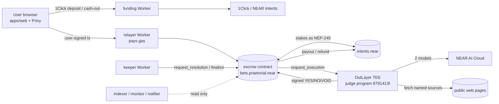

# Praetorial

An escrow in the middle and a verifiable AI judge that decides: a framework for any checkable one-on-one bet, running on NEAR mainnet.

**Live:** https://praetorial.com · **Code:** https://github.com/familiarcow/praetorial ·
**Tracks:** Unstoppable DeFi · Privacy & Private AI · Real-World Money · Open Innovation ([how it fits](#tracks))

## The problem

People make big one-on-one bets in public, and somebody has to hold the money and decide who won. When Jason Calacanis and Grant
Cardone agreed a Bitcoin bet on X, Cobie offered to hold the money. On Praetorial:

1. Jason writes the terms like a short contract: the claim, the deadline, the price sources (Coinbase, Bitstamp, Kraken).
2. Grant reads the terms and takes the bet.
3. The escrow contract locks both stakes. Neither side, and no operator, can move them.
4. At the deadline the judge reads the named exchanges' 1-minute prices; after a 24-hour challenge window the winner is paid.

Bet anyone on anything the internet can prove: prices, sports, weather, announcements, news. Your bet reads like a legal contract,
not a smart contract with an oracle built for one question or a third party deciding. Funds sit in a NEAR contract with zero access keys:
nobody can touch them, not even me. The judge runs in a TEE and its code is pinned on chain. Settled by the AI judge, or by a human
referee if you'd rather use Cobie.

I bet on myself: mainnet bet 2 says Praetorial wins this hackathon; the judge reads the results page after the winners are announced.

## Check every claim in 5 minutes

Verify, don't trust. Read-only, from a fresh clone; Node and curl (rows 5–6: Docker).

| # | Claim | Run | You see |
|---|---|---|---|
| 1 | A mainnet bet was ruled by the pinned judge and settled by the escrow | `node scripts/verify-bet.mjs --network mainnet 1` | `12 PASS, 0 FAIL, 0 SKIP` |
| 2 | Nobody holds a key to the escrow | `keys` (below) | `"keys":[]` |
| 3 | Only the pinned judge program's key signs rulings | `view resolver_keys` | 3rd value `8791413ff7943f5e…baa2473` |
| 4 | The judge's model pairs are on chain | `view judge_chain` | 4 pairs, e.g. DeepSeek-V4.1-Flash + GLM-5.3-flash |
| 5 | The mainnet escrow is this source | `contracts/escrow/release/build_reproducible.sh HEAD run /tmp/escrow` | `caf134a484bc68c2…31450f2f` |
| 6 | The judge program is this source | `resolver/release/build_reproducible.sh HEAD run /tmp/judge` | `8791413ff7943f5e…baa2473` |
| 7 | 38 bets settled | [docs/BETS.md](docs/BETS.md) | each bet's explorer links |
| 8 | It is live | https://praetorial.com | email login, no wallet |
| 9 | It is tested | `./test.sh fast` | 15 steps `PASS`, exit 0 |

```sh
keys() { curl -s https://rpc.mainnet.fastnear.com -H 'content-type: application/json' -d '{"jsonrpc":"2.0","id":1,"method":"query","params":{"request_type":"view_access_key_list","finality":"final","account_id":"bets.praetorial.near"}}'; echo; }
view() { curl -s https://rpc.mainnet.fastnear.com -H 'content-type: application/json' -d '{"jsonrpc":"2.0","id":1,"method":"query","params":{"request_type":"call_function","finality":"final","account_id":"bets.praetorial.near","method_name":"'"$1"'","args_base64":"e30="}}' | node -pe 'Buffer.from(JSON.parse(require("fs").readFileSync(0)).result.result).toString()'; }
keys; view resolver_keys; view judge_chain
```

To tie row 5 to the chain (`EfCgMFhe…` is NEAR's base58 of that sha256): `services/verifier/verify-escrow --network mainnet --escrow
bets.praetorial.near --expect-escrow-hash caf134a484bc68c2e6900bd03cba7b3eb29af40b67d65f61db1fe04831450f2f --offline` prints `PASS E1`, `E2`, `E3`
(E4 needs a paid live run, so it SKIPs and the command exits 3) (after `./test.sh` or `cd services && npm ci`). On Apple Silicon use a Rosetta-backed Docker (`DOCKER_CONTEXT=colima-rosetta`, about 3
minutes a build); a crashed emulated build prints no hash, so rerun it. What each check does *not* prove: `docs/VERIFY.md`.

## What's technically new

The hard problem is trusting an AI judge with money. Bring real events on chain with AI you can verify, not trust:

- **An escrow nobody controls.** `bets.praetorial.near` deleted its last access key two minutes after deploy. It holds both stakes as
  NEAR Intents (NEP-245) balances.
- **A judge pinned by hash.** The judge program runs on OutLayer in a TEE. The escrow stores its sha256 and the ruling key bound to it,
  and refuses any other signature (`resolver_keys`).
- **Code decides; models only read.** On price, sports and weather bets code computes the answer from the named feeds; one model can
  confirm it or force a VOID, never flip it. On custom bets two different AI models (the current pairs are from different companies) fill
  in a fixed form with quotes; code checks each quote verbatim against the fetched page and computes YES, NO or VOID (`quote_in`,
  `decide` in `resolver/core/src/lib.rs`).
- **Appeals.** Challenge an AI ruling within 24 hours with a bond (10% of the pot, at least $5) and the judge runs again, up to two
  rounds. Either side can concede; both can pick a human referee instead.
- **Reproducible builds.** Docker rebuilds of both programs from this source give the mainnet hashes (rows 5–6).
- **A real product.** Email login (Privy), no wallet, no gas: a relayer sends your signed actions as NEAR meta-transactions. Fund and
  cash out from other chains with NEAR Intents and 1Click, in NEAR, USDC, USDT, BTC, ETH or ZEC.

**Why NEAR.** A NEAR account can drop every key and keep running, so the escrow has no owner. NEAR Intents holds the stakes; 1Click brings
them in from other chains. Meta-transactions make gasless email accounts work. OutLayer gives the judge a TEE and a key bound to its code.

**By the numbers** (last `./test.sh fast`, 15/15 PASS): 627 escrow, 692 judge, 1,800 services, 1,489 web unit, 605 mocked browser and
933 conformance tests, 115 visual checks; 42 red-team attacks on the escrow (`docs/REDTEAM-RT1b.md`), 29 recorded red-team judge
replays; 8 live services; 6 assets; 2 reproducible builds matching mainnet.

## Bets Praetorial has settled

**38 bets settled end to end**: 15 ruled by the AI judge (one then conceded), 17 by human referees, 5 by
concession, 1 refunded as VOID after its deadline. 21 YES, 12 NO, 5 VOID; 16 built-in bet types, 22 custom; NEAR and USDC stakes. The
first real-money bet settled on mainnet on 13 Nov (19:43 ET); a second (this hackathon's result) is live.

| Bet | Kind | Ruling | How it ended | Tx |
|---|---|---|---|---|
| Mainnet #1: BTC 1-min close ≥ $68,350 at 2026-11-13 23:59 UTC, 3 NEAR a side | Price at a time | **NO**: 3-exchange median 68,252.9 | AI judge; YES side conceded, NO paid | [ruling](https://nearblocks.io/txns/2Z3Msqp1MiNRNM371DJXefGcq2wuqk3zaWU5n3hphpMk) · [payout](https://nearblocks.io/txns/FU2bDnHQzuVGhKgDTZMybXsJ7sjtLHc1JcwPCG5ronnK) |
| Mainnet #2: Praetorial wins this hackathon (Grand Prize or a track), 3 NEAR a side | Custom | awaiting ruling (by 2026-11-25) | taken, stakes locked | [take](https://nearblocks.io/txns/BSkEdoAVMUFb7ohswMfDwDRZ2DP5eCwvy2JkRh1iCAvz) |
| BTC 1-min close ≥ $74,500 at 2026-11-11 21:00 UTC, 25 USDC | Price at a time | **YES**: median 74,590.6 | AI judge, paid | [ruling](https://testnet.nearblocks.io/txns/J5uB9nagmWNQhbMM7GBxvbuJj26KX2UKCvHqRaRV64C6) |
| Knicks win NBA game 401909960 (2026-11-10) | Sports | **YES**: MIL 85, NY 117 (ESPN) | AI judge, paid | [ruling](https://testnet.nearblocks.io/txns/97s9UP6Zt7XKk6pbNamswZ9Kte1z5yhXApSY81t6XbQj) |
| NWS daily high, Central Park, 2026-11-11 ≥ 63 °F, 15 USDC | Weather | **YES**: NWS and IEM both 63 °F | AI judge, paid | [ruling](https://testnet.nearblocks.io/txns/HoZ8AUPpkAhGq1KaB9xsJMXLJF75wfXx6R4yWApfvC1j) |
| NOAA planetary Kp ≥ 2.00, 21:00–24:00 UTC 2026-11-11, 15 USDC | Custom | **NO**: Kp 1.33 (NOAA), 1.0 (GFZ), quoted by both models | two models agreed, paid | [ruling](https://testnet.nearblocks.io/txns/475L2LnnHzJhhtmWUJr2Lt1gxKt727tD5rVCvhBHTcX8) |
| BTC 1-min close ≥ $74,400 at 2026-11-11 20:30 UTC, 20 USDC | Price at a time | **YES**, challenged with a bond | re-judged YES, paid | [bond](https://testnet.nearblocks.io/txns/4N3EanAwrJ4yStku1fwovW1UeVC5aTfyHnuHyGVHjwKW) · [2nd ruling](https://testnet.nearblocks.io/txns/BEZLGN6Xi76fCiYyKNQrv3izZpFJYeV3v7e8NmW1jo3J) |
| BTC trades ≥ $74,100, 22:01–23:12 UTC 2026-11-10 | Hits a price | **VOID**: checking model did not confirm code's NO | AI judge, refunded | [ruling](https://testnet.nearblocks.io/txns/84AY1RbDY5pBVAsh77L39vNuo2HDtPifZSWV1xyBxoxJ) |
| Knicks beat the Cavaliers (2026-11-11), 10 USDC | Custom | **NO** | human referee, paid | [ruling](https://testnet.nearblocks.io/txns/DurcUMBCHfeGBH3X2duvEDwz8q4dcXbqeEtCvy3DDATQ) |
| BTC trades ≥ $1,000,000, 11:45–17:45 UTC 2026-11-10 | Hits a price | none needed | the NO side conceded | [concede](https://testnet.nearblocks.io/txns/4tWw9wUhpHnfAoKxAA1jdRVzmnZ85ZMYwmycEk2UB4Np) |

Same escrow code (sha256 `caf134a4…`) and judge program (`8791413f…`) as the mainnet deployment. Full list: [docs/BETS.md](docs/BETS.md).

### Verify a ruling yourself

Node only, no install, read-only (about 10 seconds):

```sh
node scripts/verify-bet.mjs --network mainnet 1
#   -> 12 PASS, 0 FAIL, 0 SKIP
```

It checks the terms hash, the ruling signature against the pinned key, the judge program's hash, the escrow's keys and every
transaction of the bet. With `2` (the open bet): 7 PASS, 2 SKIP. Limits of each check: `docs/VERIFY.md`.

## Design answers

- **What if the AI is wrong?** Code decides, quotes must match the page, custom bets need two models to agree, and either side can
  challenge.
- **What if the operator cheats?** 0 access keys; rulings only from the pinned judge's key. The guardian can pause new offers, change
  limits after 24 hours' notice, add a backup model pair after 7 days', or shut down for good (open bets are then refundable). It has no
  way to move a stake or pick an outcome.
- **What if a source lies or goes down?** A quote not on the page doesn't count and missing data is never a NO. A YES or NO pays the winner, unless no ruling can be made in time (for example someone uses up the 3 paid runs early); then both sides are refunded. If no valid ruling arrives within 7 days of the deadline, both stakes are refunded with no protocol fee; the small terms-storage charge is not refunded.
- **Is this just a demo?** Two mainnet bets with real NEAR (one settled, one live) and 37 settled testnet bets (`docs/BETS.md`).

## Try it (mainnet, real money)

Two browsers or two emails, one per side. Minimum stake $10 per side.

1. https://praetorial.com: enter an email, **Send code**, type it. You see your account with a NEAR account.
2. **Account → Add money**: send NEAR, USDC, USDT, BTC, ETH or ZEC to the address shown; the balance appears shortly.
3. **Create bet → Price at a set time**: coin, level, time, **Next**, **AI judge**, **Review**, open. In the second browser open the share
   link and **Take**. After the deadline the bet page shows the ruling, the 24-hour challenge window, then the payout. **Verify** re-checks
   the terms hash and ruling signature in your browser.

Free: the testnet app https://praetorial-web-testnet.familiarcow.workers.dev (**Account → Get test NEAR**).

## Quick start (fresh clone: build and all tests)

Needs git, Node 26 + npm, Rust via rustup (`contracts/` pins its toolchain in `rust-toolchain.toml`), Python 3, and ~600 MB of disk for
Playwright Chromium. No keys, no `.env`.

```sh
git clone https://github.com/familiarcow/praetorial && cd praetorial
./test.sh fast          # builds the contract and judge, runs every offline test; prints a PASS/FAIL table, exit 0 = all green
```

Do: `./test.sh fast`. See: 15 steps, each `PASS`, exit code 0 (about 40 minutes on an M-series Mac). It installs its own npm and Python
deps. Web app: `cd apps/web && npm run dev`, open http://localhost:3000/docs (testnet). Steps: `docs/STATUS.md`; policy: `TESTING.md`.

## Architecture

The site is a wrapper that helps you write the contract; the escrow and the judge do the work.

- `contracts/escrow`: the escrow (Rust). `resolver/`: the judge (`core` decides, `wasm-bin` runs on OutLayer).
- `services/workers/*`: 8 Cloudflare Workers (relayer, keeper, indexer, monitor, notifier, registry, sourcecheck, funding); none can move
  funds or choose an outcome. `apps/web`: the React app. `services/verifier`, `scripts/verify-bet.mjs`: read-only verifiers.



Deployed accounts: `docs/STATUS.md`. Every folder: `docs/REPO-MAP.md`.

## Tracks

- **Unstoppable DeFi.** Peer-to-peer escrow with no custodian: 0 access keys, stakes in NEAR Intents, settled on chain.
- **Privacy & Private AI.** The AI judge runs in a TEE on OutLayer with NEAR AI Cloud models; only its pinned program's key signs rulings.
- **Real-World Money.** Email login, gasless meta-transactions, USDC and USDT stakes, deposits and cash-outs to other chains via 1Click.
- **Open Innovation.** Bets written like contracts, settled by a judge anyone can check, for any question with a public source.

## Roadmap (not built yet)

- **Open evidence:** zkTLS proofs of the pages the judge read, so anyone can re-check a ruling's inputs.
- **Bounded search:** let the judge look for the answer within named sites, not only named pages.
- **New bet shapes:** more built-in bet types, and multi-person pools on the same escrow and judge.
- **DAO referee:** a DAO (e.g. Sputnik DAO) as the human referee.

## Hackathon

- **Timeline.** First commit 2026-11-01 21:27 -05:00, inside the 2026-11-01 to 2026-11-14 window; no pre-hackathon baseline. History is
  squashed for the public release; the `hackathon-submission` tag will mark the submitted commit.
- **Built with AI coding agents** (Claude Code), directed and reviewed by familiarcow. Main libraries: `near-sdk`, `near-api-js`, React,
  Privy, Playwright (full lists: `package.json`, `Cargo.toml`).
- **License:** MIT (`LICENSE`). **Team:** familiarcow (solo). The hosted demo stays up through at least 2026-11-25.

## Known limits

Details: [docs/LIMITS.md](docs/LIMITS.md).

- **Unaudited, two weeks old.** Mainnet bets use real money; only bet what you can afford to lose. No maximum stake per side.
- **Stakes are never paid to the wrong side**, but three gaps can cost the winner their winnings: the 3 paid runs can be used up early
  (refund instead of payout); a bet made outside the app without stored terms can be forced to VOID (the app never makes these and won't
  take them); a custom bet whose source can't be read ends as VOID at once. Fixes: the next escrow version and the keeper.
- **Trust in OutLayer and NEAR AI Cloud.** The escrow checks the judge's signature, not the TEE attestation (`docs/VERIFY.md` E4). Models
  are not fully deterministic; a re-run can differ.
- **Sports bets: today and tomorrow only**, until the keeper waits for a game to end.
- **Cross-asset bets.** The contract supports each side using a different token; the app creates same-token bets for now.
